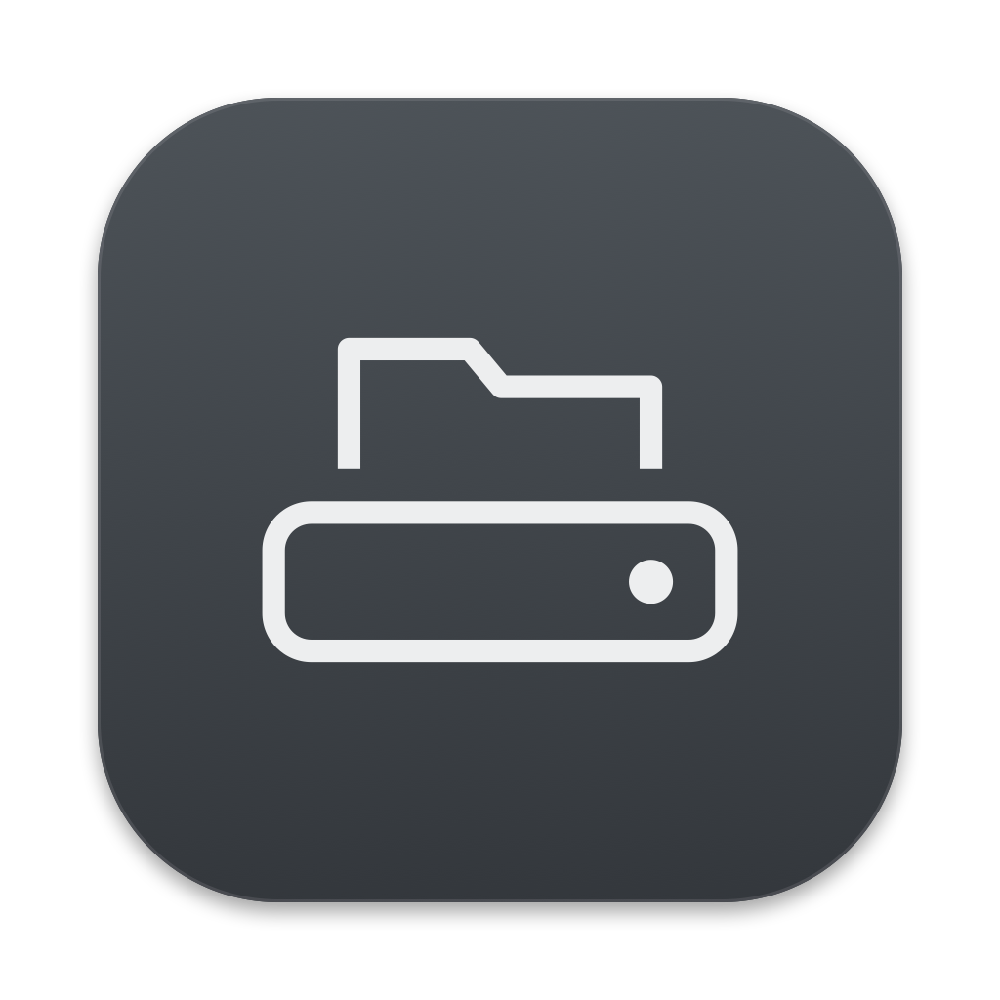
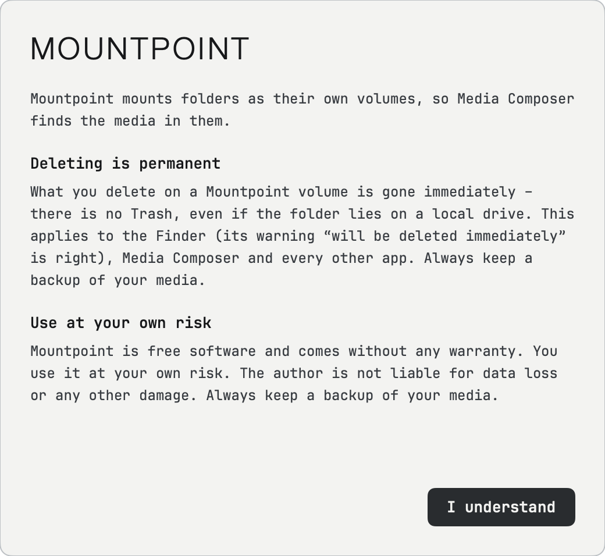
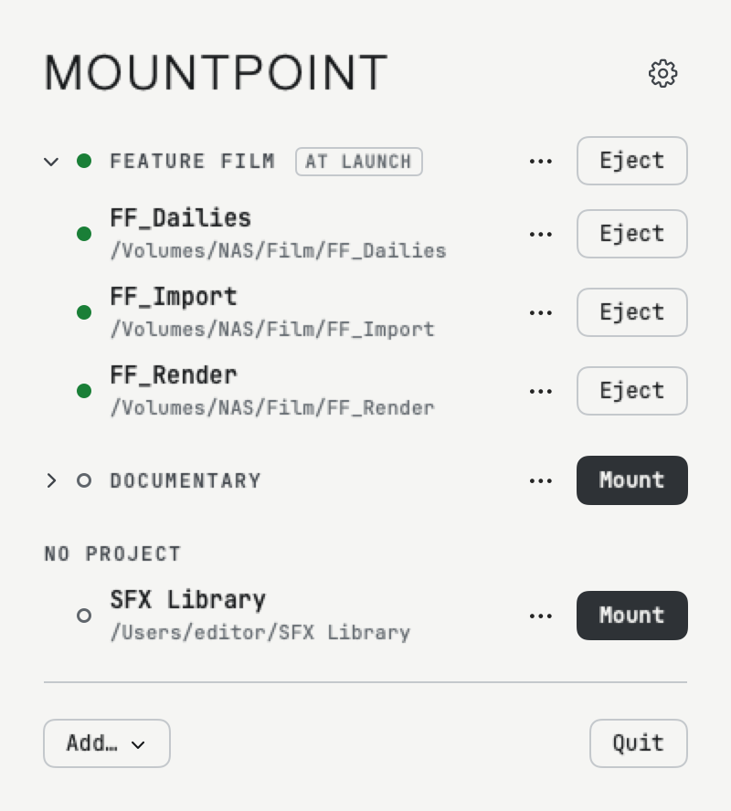
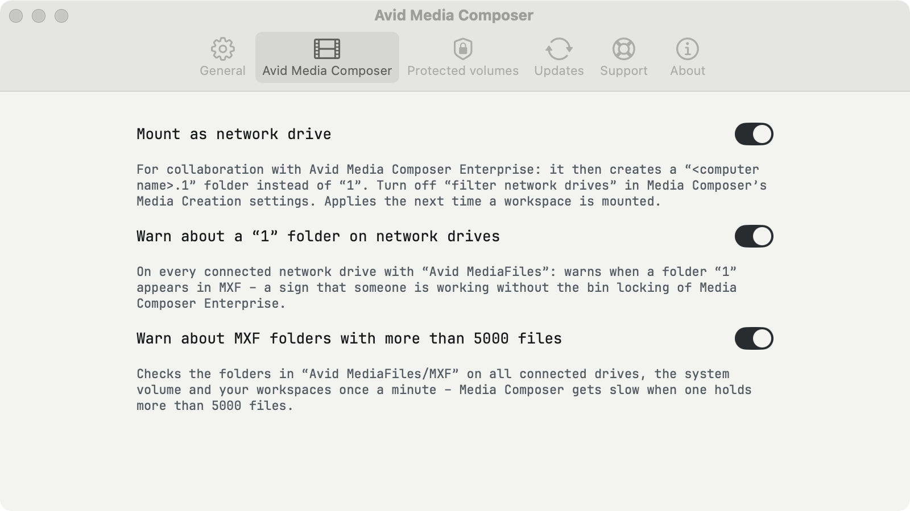
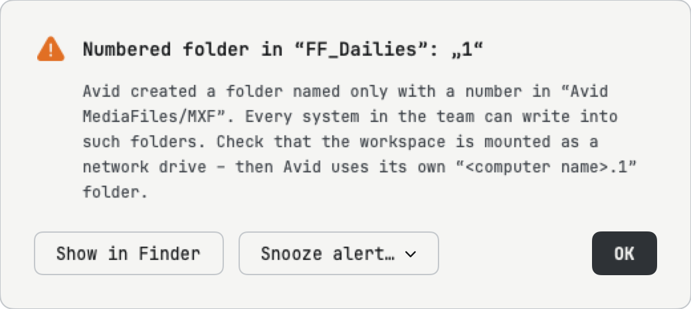

<h1 align="center">&nbsp;&nbsp;MOUNTPOINT</h1>

<p align="center"><code>menu bar app</code>&nbsp;&nbsp;<code>macOS 13+</code>&nbsp;&nbsp;<code>free · GPL-3.0</code></p>

A small macOS menu bar app that mounts any folder as its own volume – from a local disk, an archive drive or a NAS.

Built for Avid Media Composer: Media Composer only finds media in an `Avid MediaFiles` folder at the **root** of a volume. With Mountpoint, a folder like `/Volumes/Archive/2024/Documentary/AI_Media` becomes the volume `AI_Media`, with `Avid MediaFiles` right at its top.

<p align="center"></p>

*Deutsch · Français · Español: Einstellungen (Zahnrad) → Sprache · Réglages → Langue · Ajustes → Idioma.*

> Please report problems in [Issues](../../issues).

## Features

- **Workspaces** – folders that are mounted as volumes. The volume name is the folder name.
- **Projects** – group workspaces, mount or eject a whole project with one click, and mount projects automatically when the app starts.
- **NAS without Finder** – Mountpoint remembers the network share of a workspace and connects it itself when needed (credentials from the Keychain). The folder picker can also connect to a share directly (`smb://nas/Archive`).
- **Create folders** – create new workspace folders, with `Avid MediaFiles/MXF` inside, directly from the folder picker.
- **Media Composer Enterprise collaboration** – by default workspaces are mounted as *network drives*. Media Composer Enterprise (from version 2026.8 on) then creates a `<computer name>.1` media folder instead of `1`, like on shared storage, so several systems (e.g. synced with Syncthing) never write into the same folder. Turn off *filter network drives* in Media Composer's Media Creation settings. Can be switched off in the settings.
- **Protected volumes** – get an alert as soon as Media Composer creates `Avid MediaFiles` on a volume where it should never write (e.g. LucidLink), or – per volume – only when your own Media Composer creates its folder there. The Mac's system volume can be protected too. Alerts can be snoozed per volume (5 min … rest of the day).
- **Warning about a `1` folder on network drives** – a setting: on every connected network drive with `Avid MediaFiles`, an alert as soon as a folder `1` appears in `Avid MediaFiles/MXF` – a sign that someone works without the bin locking of Media Composer Enterprise.
- **Warning about big MXF folders** – a setting: an alert as soon as a folder in `Avid MediaFiles/MXF` holds more than 5000 files, on every connected drive, the system volume and your workspaces. Checked once a minute in the background; unchanged folders are not counted again.
- **Updates from within the app:** Mountpoint checks GitHub for new versions, shows a notice and installs the update with one click – it replaces itself, restarts and mounts your workspaces again. You can also check by hand under Settings → Updates. Every update is signed; Mountpoint installs only updates with a valid signature.
- **Finder sidebar** – mounted workspaces appear under *Locations*, like other drives, and disappear when ejected (can be switched off in the settings).
- **Own volume icon** in the Finder and **plain-language error messages** that say what went wrong and what to do. A drive that stops responding never freezes Mountpoint. Settings → *Show log file* shows what happened – send it along when you report a problem.
- **Safe** – Mountpoint never deletes, moves or overwrites files. It never force-ejects: if Media Composer still has files open, the volume stays mounted.
- English, German, French and Spanish, light and dark appearance, launch at login.

## Good to know

- **Deleting is permanent** – there is no Trash on Mountpoint volumes, even if the folder lies on a local drive. What you delete there – in the Finder, Media Composer or any other app – is gone immediately; the Finder’s warning “This item will be deleted immediately” is right. **Always keep a backup of your media.** (macOS gives network drives no Trash, and Mountpoint mounts workspaces as network drives so that Media Composer Enterprise creates `<computer name>.1` folders.)

<p align="center"><picture><source media="(prefers-color-scheme: dark)" srcset="assets/screenshots/welcome-dark.png"></picture></p>

- **Changing settings** applies to volumes the next time they are mounted – eject and mount them once. Updates installed from within the app do this for you (from 1.0.0 beta 8 on).
- **Use at your own risk:** Mountpoint comes without any warranty; the author is not liable for data loss or other damage. Always keep a backup of your media.
- **Media Composer’s drive filter:** turn off *filter network drives* under Media Creation → Drive Filtering on every system, otherwise Media Composer hides the workspaces.

## Requirements

- macOS 13 Ventura or later, Apple Silicon or Intel
- [macFUSE](https://macfuse.github.io) – often already installed by other tools (e.g. Mimiq)

## Install

1. Download `Mountpoint-<version>.zip` from [Releases](../../releases) and unzip it.
2. Move `Mountpoint.app` to your **Applications** folder.
3. Open it once as described below.

### First launch: “Apple could not verify …”

Mountpoint is open source and is not signed with a paid Apple Developer certificate. macOS therefore blocks the first launch. You only need to allow it **once**:

1. Double-click `Mountpoint.app`. macOS shows a warning – click **Done** (or **OK**).
2. Open **System Settings → Privacy & Security**.
3. Scroll down to *“Mountpoint” was blocked …* and click **Open Anyway**.
4. Confirm with your password and click **Open Anyway** again.

Alternatively, in Terminal:

```
xattr -dr com.apple.quarantine /Applications/Mountpoint.app
```

The menu bar icon (a drive with a folder tab) appears at the top right. It is filled while at least one workspace is mounted, and a dot appears when something needs your attention. On the very first launch a short notice explains the Finder’s delete warning and that you use Mountpoint at your own risk – it appears until you click **I understand**.

## Usage

<p align="center"><picture><source media="(prefers-color-scheme: dark)" srcset="assets/screenshots/panel-dark.png"></picture></p>

- **Add… → Add workspace…** – pick the folder that contains `Avid MediaFiles` (folders that do are marked **AVID**). If it is missing, Mountpoint offers to create `Avid MediaFiles/MXF`. The picker remembers where you were last.
- **Mount / Eject** – per workspace or per project. Status dots: filled green = mounted, grey ring = not mounted, half-filled orange = partly mounted or a problem.
- **⋯ menus** – move a workspace to a project, show it in Finder, remove it; rename or delete a project, mount it at app launch, clear all its error messages (a single one goes with its ×). Removing a workspace or deleting a project never touches any files.
- **Settings (gear icon or ⌘,)** – opens the settings window with tabs: launch at login, mount as network drive, appearance (light/dark switch), language, protected volumes, version and *Check for updates*. *About Mountpoint* is at the bottom of the settings. New workspaces and projects are added with **Add…** at the bottom left of the panel. Settings are saved right away; the panel always reopens on its main page. Changing the language takes effect immediately.

<p align="center"><picture><source media="(prefers-color-scheme: dark)" srcset="assets/screenshots/settings-dark.png"></picture></p>

### Protected volumes

Choose per volume what to watch:
- **Avid MediaFiles** (default) – any `Avid MediaFiles` folder at the top level of the volume.
- **Workstation folder** (always for the system volume, which has no choice: the Media Composer installation always creates `Avid MediaFiles` there) – only the folder your own Media Composer writes into in `Avid MediaFiles/MXF`: `1` on local drives, `<computer name>.1` on network drives. Folders other systems write (e.g. on a shared cloud drive) don't alert.

The system volume (e.g. *Macintosh HD*) is listed under its Finder name; there Media Composer uses `/Users/Shared/AvidMediaComposer/Avid MediaFiles`, so that is the folder Mountpoint watches.

Mountpoint does not scan your drives. macOS notifies it when something changes at the top level of a protected volume, so it uses no CPU while nothing happens; a single check per minute acts as a safety net. Mountpoint cannot *prevent* the write – it tells you within seconds so you can stop the import or render. It never deletes the folder.

<p align="center"><picture><source media="(prefers-color-scheme: dark)" srcset="assets/screenshots/alert-dark.png"></picture></p>

## Testing and reporting problems

- **Self-test:** Settings → *Run self-test…* checks mounting, files, warnings and updates on a test disk of its own (your workspaces are not touched) and sends an anonymous report. Takes a few minutes, needs macFUSE. The Finder may ask once whether Mountpoint may control it – that tests copying with the Finder.
- **Report a problem:** Settings → *Report…* – describe what happened, optionally with your email and the anonymized log file. No GitHub account needed.
- **Test versions:** Settings → *Get test versions* also offers versions that are still being tested.

## Build

Requires the Xcode Command Line Tools and macFUSE.

```
scripts/build-app.sh            # → dist/Mountpoint.app (universal), dist/Mountpoint-<version>.zip (+ .sig)
swift test                      # unit tests
MOUNTPOINT_IT=1 swift test      # also real mounts (after build-app.sh)
MOUNTPOINT_STRESS=1 swift test --filter StressTests   # stress test before a release
```

Updates are signed with an Ed25519 key that lives only in the release Mac's Keychain (`swift scripts/update-key.swift new` once; its public key goes into `Updater.publicKey`). The build signs the zip automatically; a release needs both the zip and its `.sig`. Builds from forks need their own key. If the key is ever lost, a release that also carries an empty `Mountpoint-<version>.manual` makes older versions show a notice to install the update by hand.

Layout: `Sources/Mountpoint` (SwiftUI menu bar app), `helper/mirror.c` (pass-through file system for macFUSE), `Resources/<code>.lproj` (translations), `assets` (icon and design drafts).

## Translate

The UI is written in English (the default). To add a language:

1. Create `Resources/<code>.lproj/Localizable.strings` (copy `Resources/de.lproj/…`)
2. Add the language to `languages` in `Sources/Mountpoint/Model.swift`
3. Add the code to `CFBundleLocalizations` in `scripts/build-app.sh`

`LocalizationTests` checks that every language has every text with the same placeholders.

## License

Copyright © 2026 Moritz Poth. Mountpoint is free software under the GNU General Public License v3.0 or later – see [LICENSE](LICENSE). It comes with no warranty. Font: [JetBrains Mono](https://www.jetbrains.com/lp/mono/) (SIL Open Font License, `Resources/fonts/OFL.txt`). macFUSE is a separate product with its own license and is not included.

Sister project of MediaFiles Ferry.

*Avid and Media Composer are trademarks of Avid Technology, Inc. LucidLink is a trademark of LucidLink Corp. This project is not affiliated with either.*
